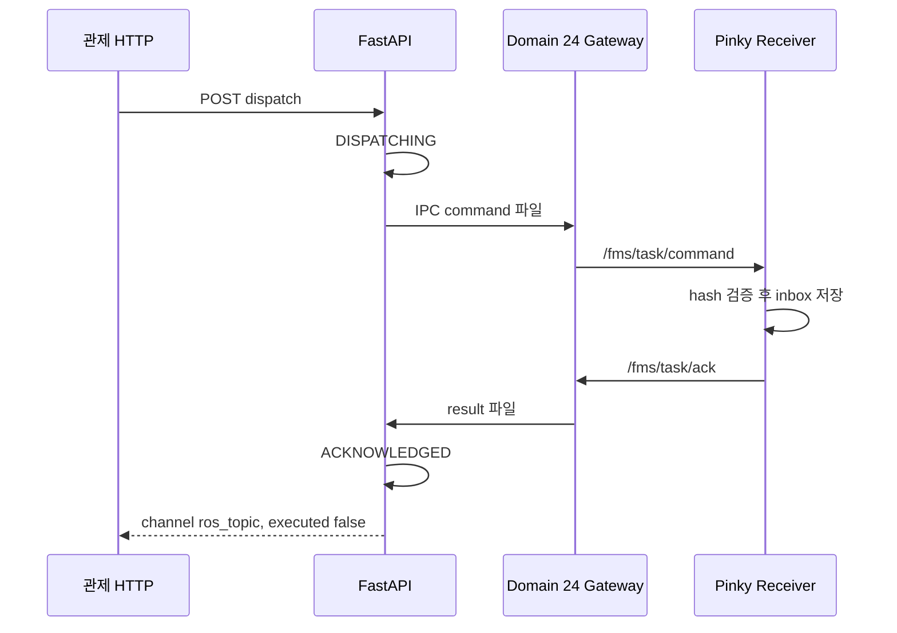
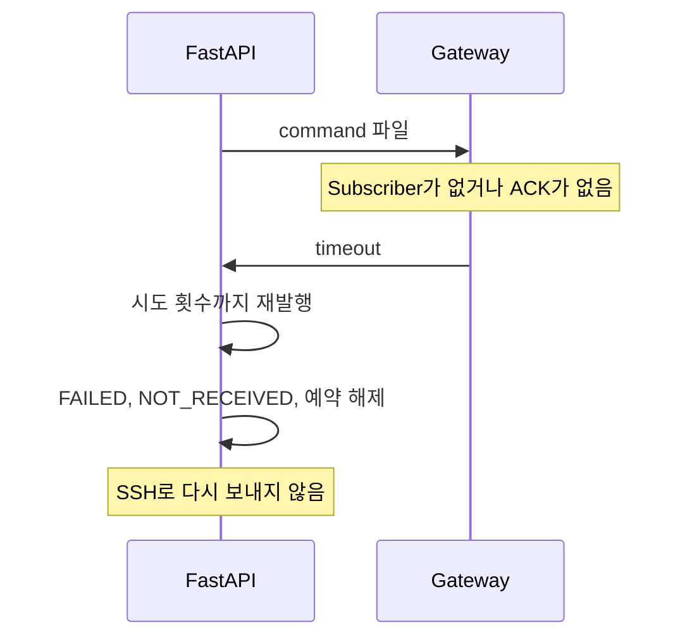
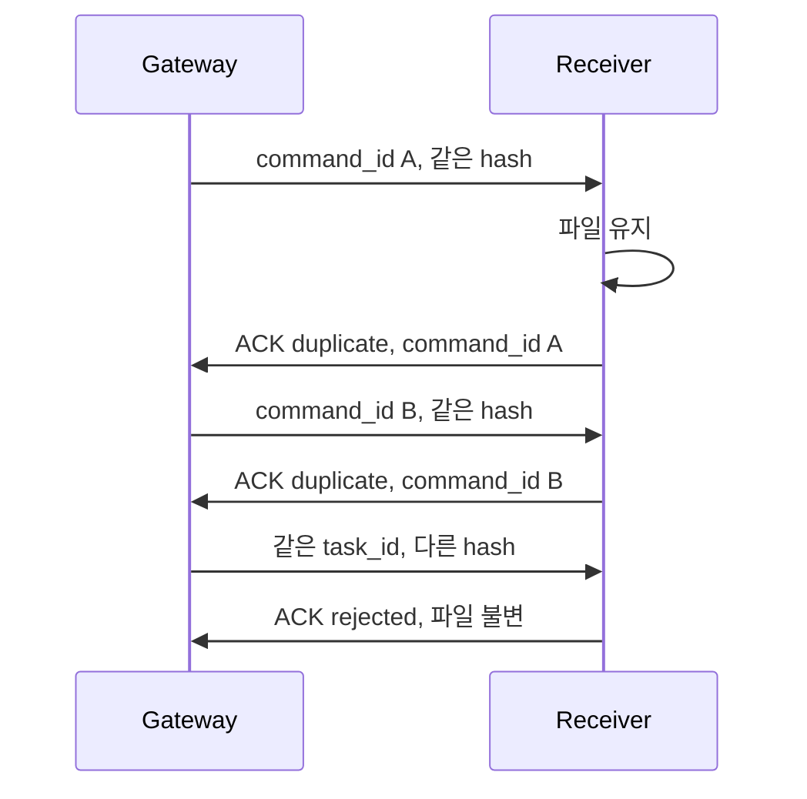
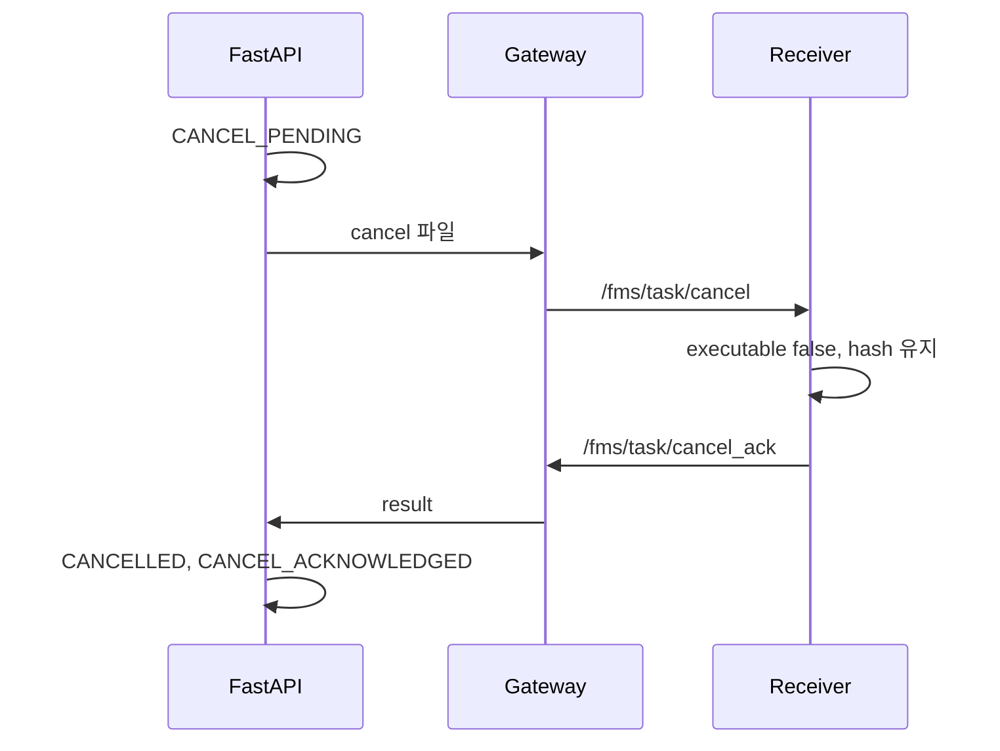
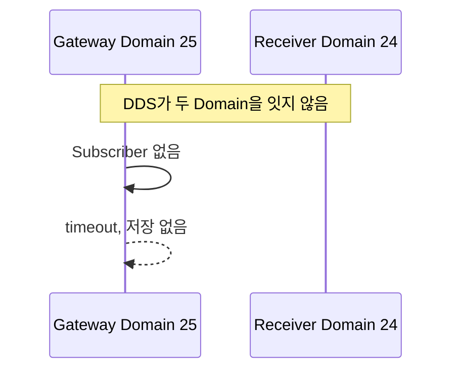
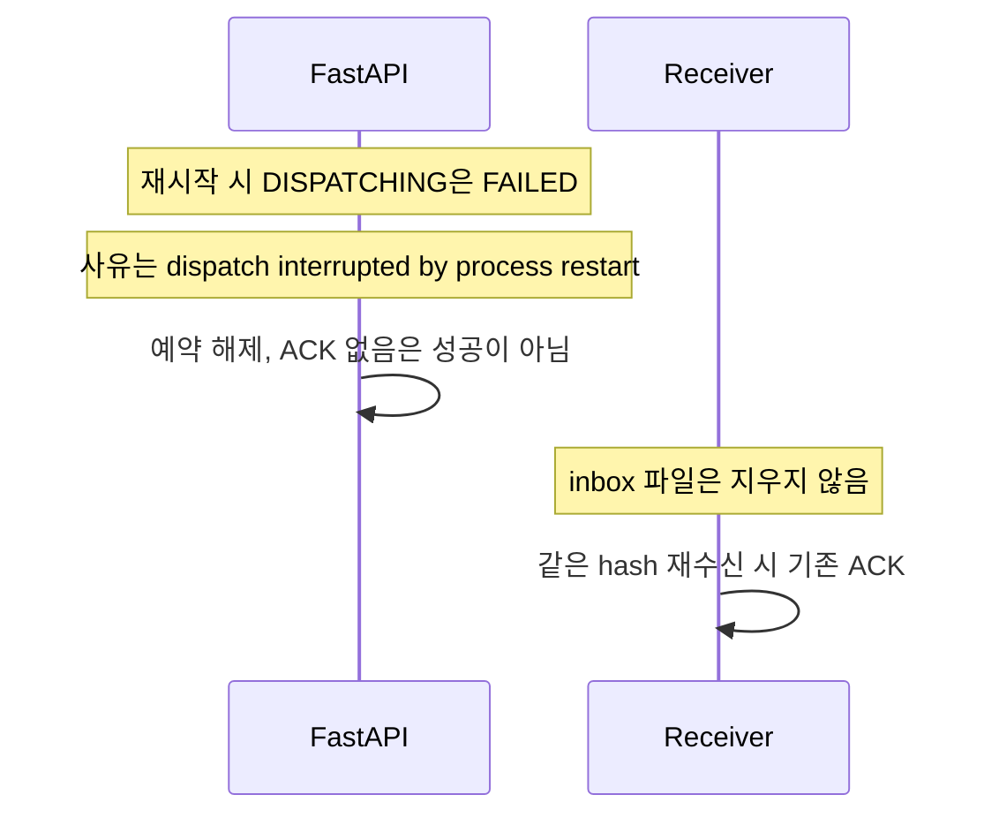

# FMS ROS 2 Topic 통신 명세

기준 구현은 `ros_ws/src/fms_msgs`, `robot_receiver/ros_task_node.py`, `robot_receiver/ros_gateway_node.py`, `backend/app/services/ros_task_gateway.py`다. FastAPI 프로세스는 `rclpy`를 올리지 않고 `ROS_DOMAIN_ID`를 바꾸지 않는다.

HTTP REST는 브라우저와 FMS 사이다. 이 문서의 Topic은 FMS Gateway와 로봇 Receiver 사이다. Nav2 Action은 Fleet Task가 호출하지 않는다.

## A. Topic 목록

같은 Topic 이름을 로봇마다 쓴다. 분리는 ROS Domain이다. QoS는 다섯 Topic이 같다.

| 항목 | 값 |
|---|---|
| Reliability | RELIABLE |
| Durability | VOLATILE |
| History | KEEP_LAST |
| Depth | 10 |

TRANSIENT_LOCAL은 쓰지 않는다. 늦게 붙은 Subscriber가 지난 Task를 다시 받으면 안 된다. RELIABLE은 소켓 전달을 돕지만, 저장과 ACK를 대신하지 않는다.

이름 기본값은 `backend/app/core/config.py`다. 환경 변수로 바꿀 수 있다.

| 설정 | 기본 Topic |
|---|---|
| `FMS_ROS_TASK_COMMAND_TOPIC` | `/fms/task/command` |
| `FMS_ROS_TASK_ACK_TOPIC` | `/fms/task/ack` |
| `FMS_ROS_TASK_CANCEL_TOPIC` | `/fms/task/cancel` |
| `FMS_ROS_TASK_CANCEL_ACK_TOPIC` | `/fms/task/cancel_ack` |
| `FMS_ROS_ROBOT_STATUS_TOPIC` | `/fms/robot/status` |

| Topic | 타입 | Publisher | Subscriber | Domain | 발행 조건 | 이동 |
|---|---|---|---|---|---|---|
| `/fms/task/command` | `fms_msgs/msg/TaskCommand` | `fms_task_gateway` | `fms_task_receiver` | 24 pinky-1. 25·26은 실물 Gateway를 띄우지 않음 | 운영자 dispatch 후, 해당 Domain에 Subscriber가 보일 때 1회 | 없음 |
| `/fms/task/ack` | `fms_msgs/msg/TaskAck` | `fms_task_receiver` | `fms_task_gateway` | 위와 같음 | 검증과 inbox 저장이 끝난 뒤, 또는 거절 직후 | 없음 |
| `/fms/task/cancel` | `fms_msgs/msg/TaskCancel` | `fms_task_gateway` | `fms_task_receiver` | 위와 같음 | 취소 요청 1회. `execute`는 false | 없음 |
| `/fms/task/cancel_ack` | `fms_msgs/msg/TaskCancelAck` | `fms_task_receiver` | `fms_task_gateway` | 위와 같음 | 저장본의 `executable=false` 반영 뒤 | 없음 |
| `/fms/robot/status` | `fms_msgs/msg/RobotStatus` | `fms_task_receiver` | `fms_task_gateway` | 위와 같음 | Receiver가 살아 있는 동안 1 Hz | 없음 |

`receiver_ready`는 이 Status의 `receiver_ready=true`이고 `task_execution_enabled=false`이며, Gateway가 그 메시지를 받은 시각 `observed_at`이 `FMS_ROBOT_STATUS_MAX_AGE_S`(기본 5초) 이내일 때만 참이다. 시각이 없거나 오래된 파일은 ready가 아니다. `ros2 node list`에 노드가 있다는 사실만으로 ready가 되지 않는다.

Pinky-2·3은 virtual이고 `physical_connection_enabled`가 false다. Domain Worker는 이 로봇에 Gateway를 띄우지 않는다. 상태 라벨은 `physical_transport_disabled`다. 가상 수신은 `channel=simulated`, receiver `fms-virtual-receiver`이며 DDS ACK로 기록하지 않는다.

## B. TaskCommand

패키지: `fms_msgs/msg/TaskCommand`. 좌표는 `map` 프레임, 단위 m. Waypoint에 계획된 heading이 없으면 `orientation_is_planned=false`이고 quaternion은 identity `(x=0,y=0,z=0,w=1)`다. 이 identity는 계획된 방향이 아니다.

Hash 원문은 `canonical_payload` 문자열이다. `payload_hash`를 뺀 canonical JSON을 `sort_keys=true`, `separators=(",", ":")`로 직렬화한 SHA-256이다. `command_id`는 hash 원문에 넣지 않는다.

| 필드 | 타입 | 필수 | 생성 | 단위 | 예 | 검증 |
|---|---|---|---|---|---|---|
| `task_id` | string | 예 | FMS |  | UUID | canonical과 같아야 함. 비면 거절 |
| `robot_id` | string | 예 | FMS |  | `pinky-1` | Receiver 자신의 ID와 같아야 함 |
| `task_type` | string | 예 | FMS |  | `navigate` | canonical과 같아야 함 |
| `map_id` | string | 예 | FMS |  | `1f_map_f` | canonical과 같아야 함 |
| `map_revision` | string | 예 | FMS |  | 지도 SHA 앞 16자 | canonical과 같아야 함. 계획 때 저장한 revision |
| `goal_label` | string | 아니오 | FMS |  | 목적지 이름 또는 빈 문자열 | canonical `goal.label`과 같아야 함 |
| `start` | `geometry_msgs/Point` | 예 | FMS | m | `x=0.2, y=0.2, z=0` | canonical start와 1e-6 m 이내 |
| `goal` | `geometry_msgs/Point` | 예 | FMS | m | `x=0.4, y=0.4, z=0` | canonical goal과 1e-6 m 이내 |
| `waypoints` | `fms_msgs/Waypoint[]` | 예 | FMS | m | waypoint_id와 pose | 개수, id, x, y가 canonical과 같아야 함. `orientation_is_planned`가 true면 거절 |
| `payload_hash` | string | 예 | FMS |  | SHA-256 hex | canonical 재계산 값과 같아야 함 |
| `command_id` | string | 예 | Gateway |  | UUID | 재전송과 ACK 상관. hash 원문 밖 |
| `canonical_payload` | string | 예 | Gateway |  | JSON 문자열 | JSON 객체여야 하고 구조 필드와 일치 |
| `execute` | bool | 예 | Gateway가 false로 고정 |  | `false` | true면 저장하지 않고 `execute_refused` |

Waypoint 하위 필드:

| 필드 | 타입 | 의미 |
|---|---|---|
| `waypoint_id` | string | 그래프 waypoint id |
| `pose` | `geometry_msgs/PoseStamped` | `header.frame_id=map`. position만 계획 좌표 |
| `orientation_is_planned` | bool | 현재 계획기는 false만 보낸다 |

## C. TaskAck

Publisher는 Receiver다. Gateway가 publish 성공만으로 이 메시지를 만들지 않는다.

| 필드 | 타입 | 의미 |
|---|---|---|
| `command_id` | string | 받은 Command의 id. FMS는 요청 id와 다르면 ACK를 거절 |
| `task_id` | string | 저장한 Task. 요청과 다르면 거절 |
| `robot_id` | string | Receiver ID. Gateway는 자기 로봇이 아니면 무시 |
| `accepted` | bool | 저장 또는 동일 Task 재ACK이면 true |
| `status` | string | 아래 표 |
| `reason` | string | 실패 설명. 성공이면 빈 문자열일 수 있음 |
| `payload_hash` | string | 저장본 hash. FMS는 요청 hash와 비교 |
| `received_at` | `builtin_interfaces/Time` | Receiver 시계. inbox JSON의 ISO 시각과 같은 순간 |
| `receiver_id` | string | `pinky-fms-receiver` |

| status | 의미 | 재시도 |
|---|---|---|
| `stored` | 새 inbox 파일 저장 | 없음 |
| `duplicate` | 같은 Task, 같은 hash. 파일을 다시 쓰지 않고 기존 ACK | 없음 |
| `rejected` | 같은 Task ID, 다른 payload 또는 필드 불일치 | 하지 않음 |
| `hash_mismatch` | `payload_hash`가 canonical과 다름 | 하지 않음 |
| `robot_mismatch` | 다른 로봇 ID | 하지 않음 |
| `execute_refused` | `execute=true` | 하지 않음 |

FMS가 ACK를 받아들이면 Task는 `ACKNOWLEDGED`다. `DELIVERED`는 수신 확인 단계의 이름이며, publish만으로 이 상태에 두지 않는다. `motion_verified`와 완료는 ACK와 별개다.

## D. TaskCancel과 CancelAck

`TaskCancel.execute`는 false만 허용한다.

| 필드 | 타입 | 의미 |
|---|---|---|
| `task_id` | string | 취소 대상 |
| `robot_id` | string | Receiver 자신과 같아야 함 |
| `cancellation_request_id` | string | 이번 취소의 상관 id. Cancel ACK 파일 이름 |
| `requested_at` | `builtin_interfaces/Time` | Gateway 발행 시각 |
| `reason` | string | 운영자 사유 |
| `execute` | bool | false |

Cancel ACK:

| 필드 | 타입 | 의미 |
|---|---|---|
| `accepted` | bool | 저장본을 취소 상태로 뒀거나 이미 취소된 동일 Task |
| `outcome` | string | `cancel_ack` 또는 `not_stored` |
| `reason` | string | 저장본 사유 또는 거절 사유 |
| `cancelled_at` | `builtin_interfaces/Time` | 저장 시각 |
| `receiver_id` | string | `pinky-fms-receiver` |

이미 취소된 Task는 파일을 다시 만들지 않고 저장된 `cancellation_request_id`를 돌려준다. payload hash와 수신 이력은 유지하고 `executable`만 false가 된다.

FMS는 Cancel ACK의 `accepted`와 task id, robot id가 맞을 때만 `CANCELLED`와 `ack_status=CANCEL_ACKNOWLEDGED`로 둔다. 그 전에는 `CANCEL_PENDING`이다. Timeout이면 취소 확정으로 바꾸지 않는다.

기본 대기 시간은 `FMS_ROS_TASK_ACK_TIMEOUT_S=8`, 시도 횟수는 `FMS_ROS_TASK_MAX_ATTEMPTS=2`다. 거절 status는 재시도하지 않는다. Timeout만 같은 `command_id`와 같은 canonical payload로 명령 파일을 다시 쓴다. Gateway는 파일이 다시 쓰이거나 Subscriber가 사라졌다가 돌아오면 VOLATILE 특성 때문에 같은 명령을 다시 발행한다. Receiver는 같은 hash면 기존 저장을 유지하고 그 `command_id`로 ACK를 다시 낸다. 늦게 도착한 ACK도 같은 `command_id`이면 그 시도의 결과로 받는다.

## E. DDS Domain

| Robot | Domain | Gateway | Receiver | 기록 |
|---|---:|---|---|---|
| pinky-1 | 24 | 실물 Worker가 `run_ros_gateway.sh`를 실행 | 로봇 또는 시험 호스트에서 `run_task_receiver.sh` | Topic ACK만 `ros_topic` |
| pinky-2 | 25 | 띄우지 않음 | 없음 | `simulated` |
| pinky-3 | 26 | 띄우지 않음 | 없음 | `simulated` |

Domain이 다르면 같은 Topic 이름이라도 DDS가 섞지 않는다. 메시지의 `robot_id`가 Receiver와 다르면 그 Domain 안에서도 거절한다. API 프로세스의 `FMS_ROS_DOMAIN_ID`는 이 표와 별개이며, Worker가 자식 환경에 Registry Domain을 넣는다.

## F. 실행과 관찰

메시지 패키지:

```bash
source /opt/ros/jazzy/setup.bash
cd /home/sw/DevSpace/FMS/ros_ws
colcon build --packages-select fms_msgs
```

환경:

```bash
source /opt/ros/jazzy/setup.bash
source /home/sw/DevSpace/FMS/ros_ws/install/setup.bash
export RMW_IMPLEMENTATION=rmw_fastrtps_cpp
```

FMS는 `./scripts/run_api.sh`다. `FMS_FLEET_DISPATCH_MODE` 기본값은 `ros_topic`이다. pinky-1 Worker가 Gateway를 띄운다. 가상 로봇 Worker는 Gateway를 띄우지 않는다.

Receiver는 대상 로봇의 Domain에서만 실행한다. Pinky-1 예:

```bash
export ROS_DOMAIN_ID=24
export FMS_RECEIVER_ROBOT_ID=pinky-1
export FMS_RECEIVER_INBOX="$HOME/fms_task_receiver/inbox"
/home/sw/DevSpace/FMS/scripts/run_task_receiver.sh
```

관찰만 하는 명령. Domain 24는 실물 그래프이므로 발행하지 않는다.

```bash
export ROS_DOMAIN_ID=24
ros2 topic list
ros2 topic type /fms/task/command
ros2 topic type /fms/task/ack
ros2 topic info /fms/task/command -v
ros2 topic info /fms/task/ack -v
ros2 topic echo /fms/task/ack
ros2 topic echo /fms/task/cancel_ack
ros2 topic echo /fms/robot/status
```

Receiver 로그는 프로세스를 포그라운드로 둔 터미널이다. inbox 파일은 `FMS_RECEIVER_INBOX` 또는 `~/fms_task_receiver/inbox/{task_id}.json`이다.

`ros2 topic pub`으로 `/fms/task/command`를 직접 보내면 실물 Receiver가 Task를 저장할 수 있다. 기본 운영에서는 하지 않는다. 시험 시에도 Domain 24에 보내지 않고, `execute`는 false여야 하며 Nav2 Goal을 만들지 않는다.

SSH 진단은 Task 전송이 아니다.

```bash
ssh -o BatchMode=yes pinky@192.168.0.83 'echo ok'
```

비밀번호 Dispatcher와 별개다. 이 명령이 실패해도 Topic 모드의 설정이 틀렸다는 뜻은 아니다.

## G. 통신 흐름

### 1. 정상 Task와 ACK



### 2. ACK Timeout



### 3. 같은 Task 재전송



### 4. 취소



### 5. Domain 불일치



명령 파일의 `ros_domain_id`가 Gateway 환경과 달라도 Gateway가 발행하지 않고 `robot_mismatch`를 쓴다.

### 6. 재시작



`CANCEL_PENDING`은 재시작만으로 `CANCELLED`가 되지 않는다. Cancel ACK가 있어야 확정한다.
